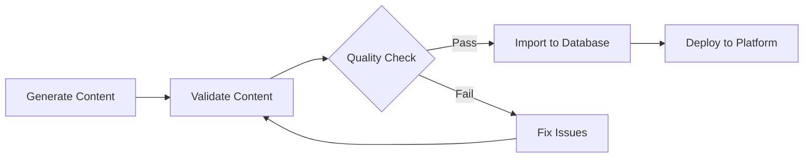

# Content Generation System

This directory contains the content generation system for evidence-based nursing questions and scenarios.

## 🚀 Quick Start

```bash
# Install dependencies
npm install

# Generate content for all body systems
npm run generate:all

# Validate all generated content
npm run validate:all

# Import all content to database
npm run import:all
```

## 📁 Structure

```
content/
├── categories/           # Body system categories
│   ├── cardiovascular/   # Cardiac, vascular, circulatory
│   ├── respiratory/      # Pulmonary, breathing, oxygenation
│   ├── gastrointestinal/ # GI, digestive, hepatic
│   ├── endocrine/        # Diabetes, hormones, metabolism
│   ├── integumentary/    # Skin, wounds, burns
│   ├── musculoskeletal/  # Bones, joints, muscles
│   ├── neurological/     # Brain, spinal cord, nerves
│   ├── genitourinary/    # Renal, reproductive, urinary
│   └── psychiatric/      # Mental health, behavioral
├── templates/            # Question templates and prompts
├── generated/            # Generated content files
├── scripts/              # Generation and import scripts
├── examples/             # Example content files
└── validation/           # Content validation tools
```

## 🛠 Usage

### 1. Generate Content

Generate content for specific categories:

```bash
# Single category
npm run generate:cardiovascular

# Custom generation
tsx scripts/generate-content.ts cardiovascular "Acute MI" intermediate 10 30 true

# All categories
npm run generate:all
```

**Parameters:**
- `category`: Body system (cardiovascular, respiratory, etc.)
- `title`: Scenario title
- `difficulty`: beginner, intermediate, advanced
- `numItems`: Number of questions to generate
- `priorityPercentage`: % of priority/assessment questions (default: 30)
- `includeOrder`: Include drag-and-drop question (default: true)

### 2. Validate Content

Check content quality and compliance:

```bash
# Single file
tsx scripts/validate-content.ts categories/cardiovascular/acute-mi.jsonl

# All files
npm run validate:all

# Generate report
tsx scripts/validate-content.ts categories/cardiovascular/acute-mi.jsonl report.md
```

### 3. Import Content

Import validated content into the database:

```bash
# Single file
tsx scripts/import-content.ts categories/cardiovascular/acute-mi.jsonl

# All files
npm run import:all

# With author ID
tsx scripts/import-content.ts categories/cardiovascular/acute-mi.jsonl user-123
```

## 📋 Content Format

All generated content follows the JSONL (JSON Lines) format:

```json
{
  "category": "cardiovascular",
  "scenario_title": "Acute Myocardial Infarction",
  "question_type": "single|multi|order",
  "prompt": "Question text...",
  "options": ["A ...", "B ...", "C ...", "D ..."],
  "correct": ["B"],
  "rationale": "Explanation with citations...",
  "difficulty": "intermediate",
  "priority_type": "assessment",
  "learning_objectives": ["Objective 1", "Objective 2"],
  "tags": ["cardiovascular", "assessment", "priority"]
}
```

## ✅ Quality Standards

- **30%** of questions should be PRIORITY/ASSESSMENT items
- **At least 1** ORDER question per scenario
- **2-3 APA-style references** from last 5-7 years in rationales
- **Professional reading level**, concise but complete
- **No brand names**, use generic medications
- **No PHI** or institutional details

## 🔧 Configuration

### Environment Variables

```bash
# Required for import functionality
NEXT_PUBLIC_SUPABASE_URL=your_supabase_url
SUPABASE_SERVICE_ROLE_KEY=your_service_role_key
```

### Customization

Edit `templates/prompts.ts` to customize:
- Category-specific prompts
- Question templates
- Difficulty levels
- Priority types

## 📊 Validation Rules

The validation system checks:

- **Schema compliance**: Required fields and data types
- **Content quality**: Rationale length, option clarity
- **Reference validity**: APA format, recent years
- **Consistency**: Question types match answers
- **Best practices**: No brand names, appropriate language

## 🎯 Question Types

### Single Choice
- One correct answer from 4-5 options
- Knowledge recall and application
- 5 points, 60-second time limit

### Multiple Choice
- Multiple correct answers
- Comprehensive understanding
- 10 points, 90-second time limit

### Order/Priority
- Drag-and-drop sequencing
- Clinical reasoning and priority setting
- 15 points, 120-second time limit

## 🏥 Body Systems

| System | Key Topics | Common Scenarios |
|--------|------------|------------------|
| **Cardiovascular** | ECG, medications, hemodynamics | MI, heart failure, arrhythmias |
| **Respiratory** | Oxygen therapy, ventilation | COPD, pneumonia, ARDS |
| **Gastrointestinal** | Assessment, nutrition, fluids | GI bleed, liver failure, obstruction |
| **Endocrine** | Glucose monitoring, hormones | DKA, hypoglycemia, thyroid crisis |
| **Integumentary** | Wound care, skin integrity | Pressure ulcers, burns, infections |
| **Musculoskeletal** | Mobility, pain management | Fractures, joint replacement, arthritis |
| **Neurological** | Assessment, GCS, seizures | Stroke, TBI, MS, Parkinson's |
| **Genitourinary** | Renal function, fluid balance | AKI, UTI, dialysis, reproductive health |
| **Psychiatric** | Mental health, crisis intervention | Suicide risk, psychosis, depression |

## 🚨 Troubleshooting

### Common Issues

1. **Validation Errors**
   - Check rationale has 2-3 recent references
   - Ensure correct answers match options
   - Verify question type consistency

2. **Import Failures**
   - Verify Supabase credentials
   - Check database schema matches
   - Ensure content is validated first

3. **Generation Issues**
   - Check category names are valid
   - Verify difficulty levels
   - Ensure sufficient content in templates

### Getting Help

- Check validation reports for specific errors
- Review example files for proper format
- Ensure all dependencies are installed
- Verify environment variables are set

## 📈 Best Practices

1. **Generate in batches** of 10-15 items per category
2. **Validate before importing** to catch errors early
3. **Review generated content** for clinical accuracy
4. **Update templates regularly** with new evidence
5. **Monitor validation reports** for quality trends

## 🔄 Workflow


